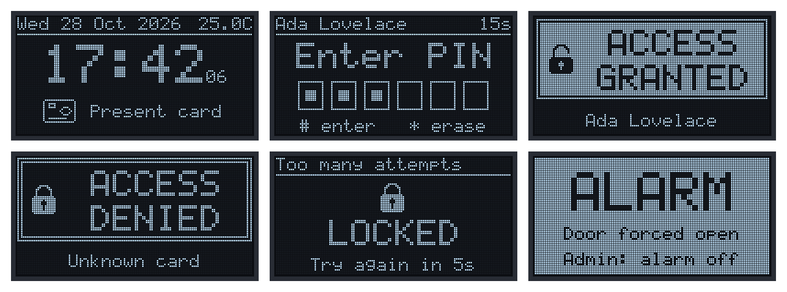
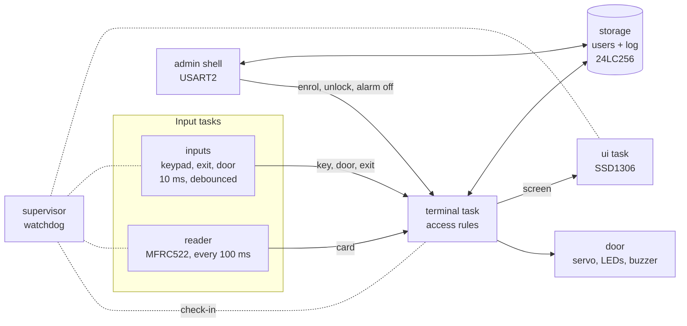
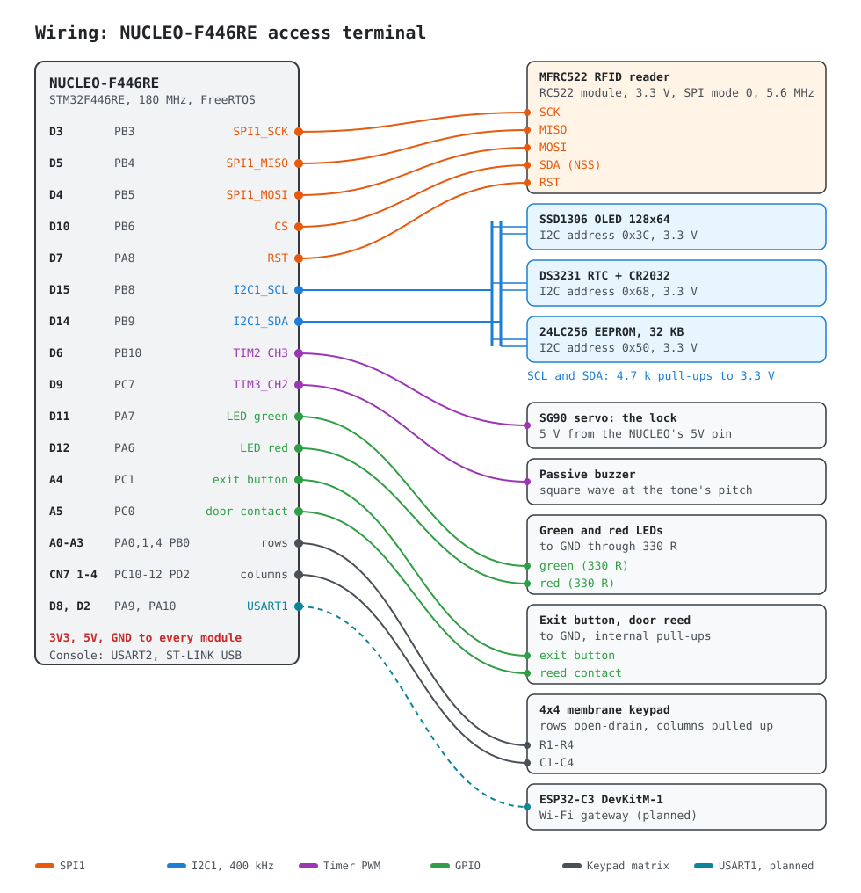

# STM32 FreeRTOS Access Control Terminal

A door access terminal on an STM32F446RE (NUCLEO-F446RE). You present an
RFID card, type your PIN on a keypad, and a servo unlocks the door. Users
and an access log live in an I2C EEPROM, and an admin shell on the serial
port manages it all.

It runs on FreeRTOS. Every peripheral driver is written on the registers,
with no vendor HAL. The same firmware image runs on the real board and in
[EmbSIM](https://github.com/EmbLinkOs/EmbSIM), a circuit and firmware
simulator. There, scripted scenarios press keys, present cards and open
the door, then check what the firmware did: the console, the OLED's
pixels, the servo's angle, the LEDs and the buzzer.



*The OLED in simulation, from the firmware's own frames: idle clock (time
and temperature from the DS3231), PIN entry, access granted, an unknown
card, the keypad lockout, the forced-door alarm.*

## Features

- **Card and PIN:** MIFARE Classic cards on an MFRC522 (SPI), each user
  with the card alone or the card and a 4 to 6 digit PIN, and optional
  hours of access (night shifts across midnight included).
- **Lockout:** after 3 wrong PINs the keypad locks out for 30 s. Each
  further lockout doubles the time, until a correct PIN.
- **Door supervision:** a door opened while locked is a forced-door alarm
  (siren, red LED) that only an admin clears. A door held open past its
  limit counts down on screen, then alarms until closed. The exit button
  always opens: nobody is ever locked in.
- **Users and access log** in a 24LC256 EEPROM: one 64-byte page per
  user, a 256-entry log ring, every record CRC-checked. PINs are salted
  SHA-256 hashes stretched over 1024 rounds and compared in constant time.
- **Real-time clock:** DS3231 with a coin cell. Log entries are
  timestamped, and the terminal knows when its time can't be trusted.
- **Admin shell** over the ST-LINK's USB serial port, behind a PIN login:
  enrol a card by presenting it, manage users, read the log, open the
  door, clear an alarm, change the timings, set the clock.
- **Robustness:**
  - A supervisor feeds the independent watchdog only while every task
    checks in, and names a stalled task in the fault record.
  - Hard faults (with the stacked PC/LR and CFSR), assertions, stack
    overflows and failed allocations survive the reset and are reported
    at the next boot.
  - The I2C driver recovers a bus held by a slave.

## Architecture



The access rules ([`firmware/lib/access.c`](firmware/lib/access.c)) are a
state machine fed with events. It reaches the hardware, the storage and
the screen only through callbacks, and one task owns it, so it needs no
locking. The same code runs in the unit tests with fakes and a fake
clock.

| Layer | | |
|-------|-|-|
| [`platform/`](firmware/platform) | startup, linker script, clocks, fault record, FreeRTOS config, pin map | registers |
| [`drivers/`](firmware/drivers) | GPIO, UART (interrupts, stream buffers), I2C (event/error interrupts), SPI, timer PWM, watchdog | registers |
| [`devices/`](firmware/devices) | MFRC522, SSD1306, DS3231, 24LC256, keypad | drivers |
| [`lib/`](firmware/lib) | access rules, user database, access log, SHA-256, CRC, screens, graphics, shell, dates, printf | portable C, unit-tested on the host |
| [`app/`](firmware/app) | tasks: terminal, reader, inputs, ui, admin, supervisor; storage; door | FreeRTOS |

## Testing

**Unit tests** of everything in `lib/` run on the host with the address
and undefined behaviour sanitizers. They cover:

- every access rule, with a fake clock (lockout backoff, alarms, egress,
  the counter wrapping)
- the storage on a RAM fake, with power cuts, corrupted records and
  failing writes
- SHA-256 against the FIPS 180-4 vectors, plus every screen

```sh
cmake --preset host && cmake --build --preset host && ctest --preset host
```

**System tests** run the real firmware image in EmbSIM against the
circuit in [`sim/project.json`](sim/project.json):

```
$ tools/simtest.py
PASS  boot                   9/9      8.4 s
PASS  clock-and-display      9/9     12.6 s
PASS  access-flow           13/13    28.6 s
PASS  alarms                15/15    27.4 s
PASS  lockout                9/9     60.4 s
5/5 scenarios passed
```

| Scenario | What it does |
|----------|--------------|
| [boot](sim/scenarios/boot.json) | clock at 180 MHz, devices up, heartbeat, the shell answers |
| [clock-and-display](sim/scenarios/clock-and-display.json) | I2C scan, setting the clock, the DS3231's temperature, the OLED's clock |
| [access-flow](sim/scenarios/access-flow.json) | unknown card denied; enrolment by presenting the card; card and PIN; servo to 90 degrees; the door opens, closes and relocks |
| [alarms](sim/scenarios/alarms.json) | forced door: siren and red LED; a non-admin refused; an admin's card clears it; the exit button during the alarm |
| [lockout](sim/scenarios/lockout.json) | three wrong PINs, cards ignored meanwhile, the right PIN after |

Simulation found three bugs a bench would have hidden or made
intermittent:

- **An I2C race.** After the register address of a read, BTF stays set
  until the repeated START goes out, so the interrupt re-entered at once
  and read two stale bytes. The DS3231's temperature came back as its
  register address.
- **A FreeRTOS task notification eaten by the wrong wait.** The display
  task's "redraw" signal ended its own I2C transfer early.
- **A GPIO written before its clock was on.** Silicon ignores that write
  silently; EmbSIM flagged it.

## Admin shell

At 115200 8N1 on the ST-LINK's virtual COM port. A real session, from the
access-flow scenario:

```
access-terminal 1.0.0: STM32F446RE at 180 MHz (HSE), reset: power-on
[    0.199] storage: blank EEPROM: formatted, admin PIN is the default (1234)
[    0.207] supervisor: running; watchdog 3000 ms
> [    0.307] reader: MFRC522 v2.0 (version 0x92)
[    0.628] access: denied: unknown card 04:A1:B2:C3
login 1234
logged in
warning: the admin PIN is the default: change it (passwd)
> user add card "Ada Lovelace" 2468
present the new card (20 s)...
[    1.968] access: user added (Ada Lovelace)
user 0: Ada Lovelace, card 04:A1:B2:C3, card+PIN
> [    4.354] access: granted (Ada Lovelace)
```

`help` lists the commands: `status`, `time`, `login`, `logout`, `passwd`,
`user` (`list`, `add`, `del`, `pin`, `admin`, `enable`, `disable`,
`hours`), `log`, `door open`, `alarm off`, `config`, `wipe`, `top` (CPU
and stack per task), `faults`, `i2c`, `reboot`.

## Hardware

The parts list and the wiring are in [docs/hardware.md](docs/hardware.md).



## Building and flashing

The firmware needs the [Arm GNU Toolchain](https://developer.arm.com/downloads/-/arm-gnu-toolchain-downloads)
(`arm-none-eabi-gcc`), CMake 3.20 or later and Ninja.

```sh
cmake --preset firmware
cmake --build --preset firmware        # build/firmware/access-terminal.elf and .bin
```

To flash a NUCLEO, copy `build/firmware/access-terminal.bin` to the board's
USB drive, or use STM32CubeProgrammer or `st-flash`. The image is 45 KB of
flash and 74 KB of RAM, 64 KB of which is the FreeRTOS heap.

## Roadmap

- An ESP32-C3 as a Wi-Fi gateway for the access log, on USART1 with a
  framed, CRC-checked protocol.
- Card authentication beyond the UID: a per-card secret in a MIFARE
  sector, so a cloned UID alone doesn't open.

## License

MIT, see [LICENSE](LICENSE). The files in [`third_party`](third_party) keep
their own licenses: the FreeRTOS kernel is MIT, CMSIS and ST's device
header are Apache-2.0.
